<p align="center">
  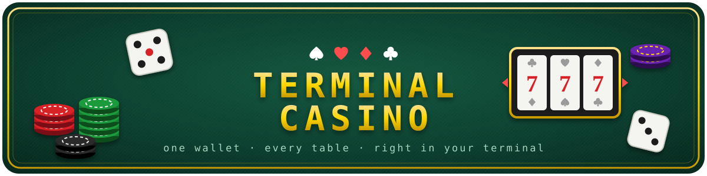
</p>

<p align="center">
  
  
  
  
  
  
</p>

<p align="center">
  <a href="#a-tour">Tour</a> ·
  <a href="#how-it-works">How it works</a> ·
  <a href="#quickstart">Quickstart</a> ·
  <a href="#games">Games</a> ·
  <a href="#adding-a-game">Add a game</a> ·
  <a href="docs/GAME_SPEC.md">Plugin spec</a> ·
  <a href="#roadmap">Roadmap</a> ·
  <a href="CHANGELOG.md">Changelog</a>
</p>

---

**Terminal Casino** is a casino floor that runs in your terminal. Slide through the games in the lobby, pick a table, play, and walk back out with your winnings. One wallet follows you to every game, and your profile remembers your bankroll, your stats and every hand you've played.

The games aren't built into the casino. Each one is its own project, added as a plugin. The casino owns the lobby, the wallet and the bookkeeping. A game only has to take a balance, play, and hand a balance back. A compliance checker makes sure it plays by the rules before the casino lets it in.

<picture>
  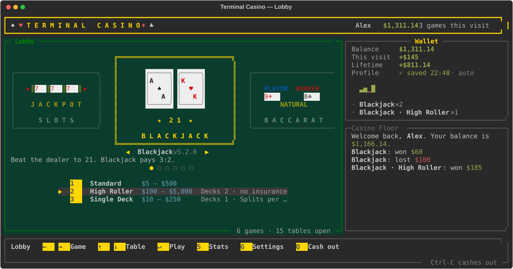
</picture>

The lobby is a carousel. The game you're on sits in the middle in a gold frame, with its neighbours dimmed on either side. `←` `→` slides to the next game, `↑` `↓` picks one of its tables, and `↵` sits you down.

## What it does

- **Runs a casino floor, not a menu.** Blackjack, Roulette, Baccarat, Craps, Slots and Texas Hold'em, each at one or more tables, like a $5 table, a high-roller room and a single-deck variant. Each table has its own stakes and rules.
- **Keeps one wallet across every game.** Your balance moves from table to table, and the casino records every result.
- **Remembers you.** Type your name and you're back where you left off: balance, lifetime stats, history. It autosaves, or you can save by hand.
- **Lets anyone add a game.** Drop a folder into `plugins/`, run the checker, and it's on the floor. Games stay runnable on their own.
- **Lives entirely in the terminal.** It's full-screen and driven by single keys. Cards slide in and flip, the roulette ball runs the rim and drops into a pocket, and every game shares the same look and controls.

## A tour

### Pull up a chair

<picture>
  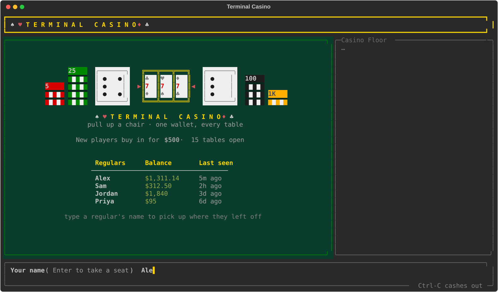
</picture>

Type a name to sit down. Regulars are listed with their balance and when they last played. A returning name, in any capitalisation, picks up their profile. A new name buys in fresh.

### At the table

<picture>
  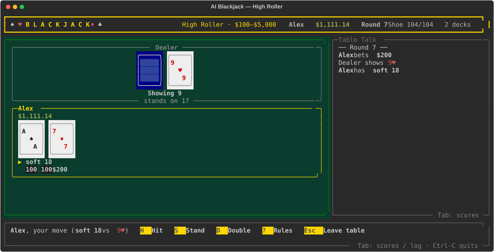
</picture>

Choosing a table hands the terminal to the game. Here, [AI Blackjack](https://github.com/ianjackson8/ai_blackjack) is playing the High Roller table: 2 decks, no insurance, and bets from $100 to $5,000. The casino passed it those settings. Leave the table and you're back in the lobby with your new balance, logged and saved.

### Roulette

<picture>
  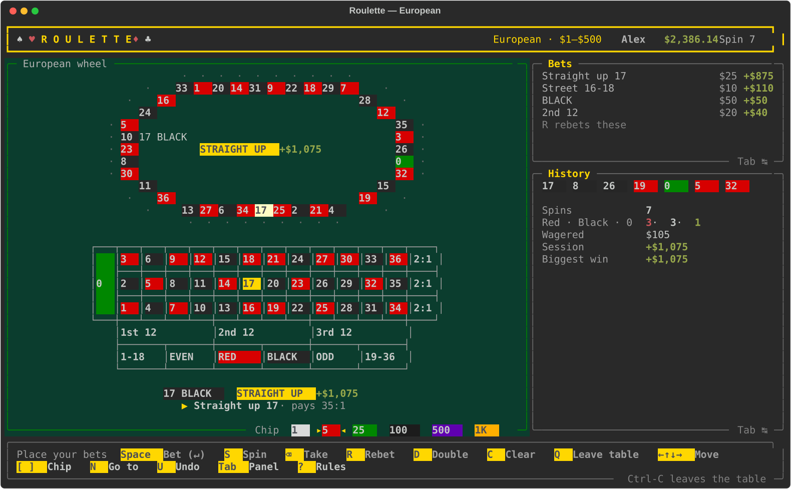
</picture>

Move around the layout and drop chips on straight-ups, splits, streets, dozens and colours. Then spin. The ball runs the rim for about three seconds, drops, bounces through a couple of pockets and settles. Nothing is revealed until it lands. Tables can run a European or American wheel, with or without la partage.

### Baccarat

<picture>
  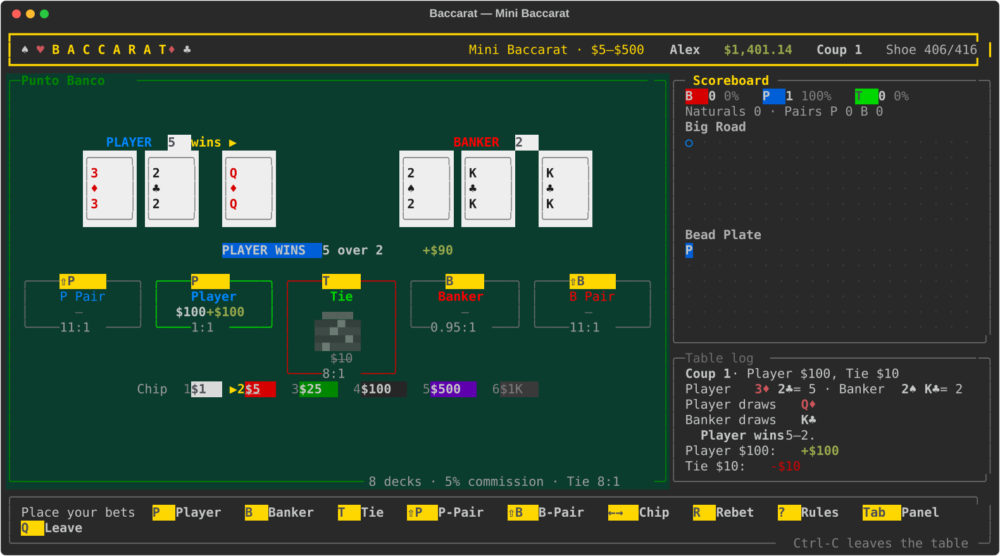
</picture>

Punto Banco: back the Player, the Banker or a Tie, plus optional pair bets. The cards slide in and flip one by one, with the third-card rules played out for you. Big Road and Bead Plate scoreboards follow the shoe. Tables can change the decks, the Banker's commission and the Tie payout.

### Craps

<picture>
  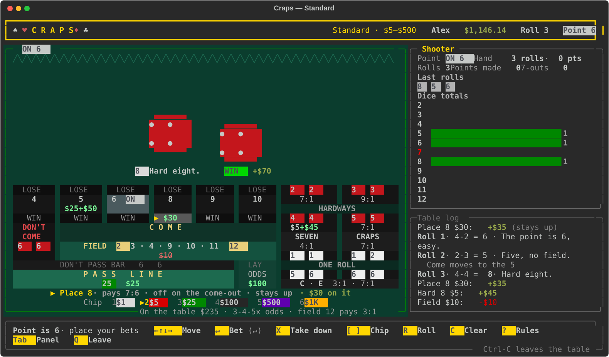
</picture>

You're the shooter at a table laid out like the real thing. Six number boxes each have a LOSE, number and WIN strip. Below them are the Don't Come bar, Come, the Field, the Don't Pass bar and the Pass Line with its odds. A props panel holds the hardways, Seven, Craps, the one-roll bets and C & E. Walk the cursor over the felt and drop chips, then throw. The dice are flung in from the right, hit the back wall, bounce and tumble to a stop, and nothing pays until they land. Contract bets roll out before you leave, so the balance you take back is always exact. Tables set the maximum odds (1x up to 10x), what the Field's 12 pays, and whether props are on offer.

### Slots

<picture>
  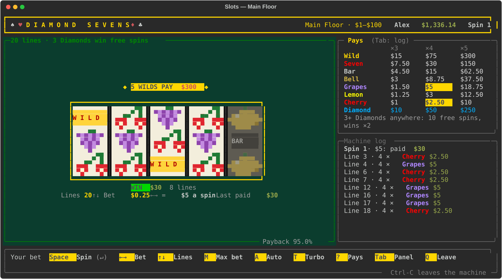
</picture>

<picture>
  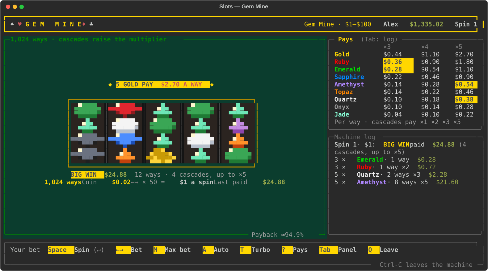
</picture>

Four machines, each with its own cabinet, art and mechanics. A table picks the machine:

| Machine | How it plays |
|---|---|
| **Diamond Sevens** | Five reels and up to 20 lines, Wilds, and Diamond scatters: 3 or more award 10 free spins at double pay |
| **Gem Mine** | 5×4 reels, 1,024 ways. Wins shatter and the gems cascade down, and each cascade raises the multiplier ×1 → ×2 → ×3 → ×5 |
| **Brass Bell** | A classic 3-reel mechanical with a lever: blanks, mixed bars, lone cherries, and 2× wilds that multiply |
| **Night Sky** | Star wilds walk one reel left on every respin, and stars that meet merge into a 2× (up to ×10) |

A spin only gets a **WIN** badge when you come out ahead: one that pays back less than it cost just says "Paid". A cascade or a respin chain is judged as a whole. Autoplay runs a set number of spins, and any key stops it. Each table sets its machine, its paylines, its payback (92%, 95% or 97%, exact or measured and tested) and whether autoplay is allowed.

### Texas Hold'em

<picture>
  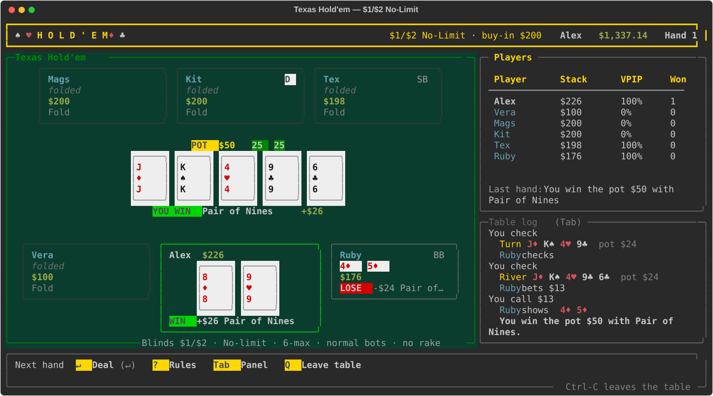
</picture>

No-limit or pot-limit Hold'em against up to five bots, on easy, normal or hard. Cards slide in and flip, the bots take a moment to think (any key hurries them), and the showdown is revealed card by card. A table's minimum is its **big blind**, and its maximum is the **max buy-in**. You sit down with up to the max buy-in, the rest of your balance stays in your wallet and tops your stack up between hands, so you never risk more than the buy-in on one hand. Leaving mid-hand folds your cards, and the bots play it out without you. Tables set the seats (2–6), the betting, the rake and how good the bots are.

### One house style

Every game follows the same house style from the [plugin spec](docs/GAME_SPEC.md#5-design-guidelines):
- a gold header showing the table and its limits
- cards that slide in face down and flip
- chip stacks for your bets, and WIN / LOSE badges
- `?` for the rules, `Q` to leave, and a session summary on the way out

### Tables, configured by the house

<picture>
  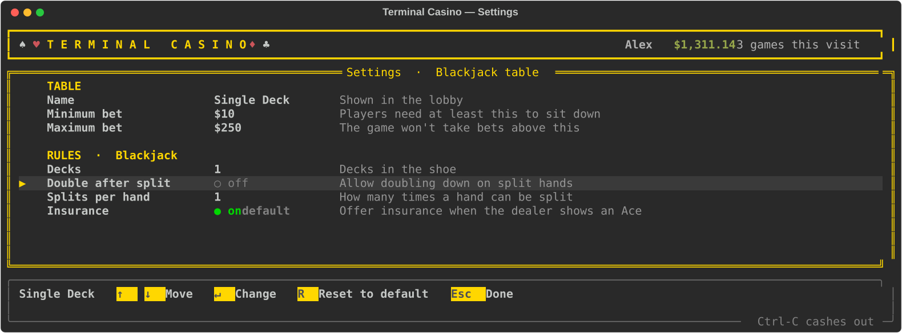
</picture>

Open **Settings** (`G`) to add, duplicate, edit or close tables. Each game declares the rules it accepts, and the editor offers exactly those: on/off switches, lists to pick from, and numbers with limits. Anything you don't change stays at the game's default. The game then enforces the table's limits and rules.

### Stats

<picture>
  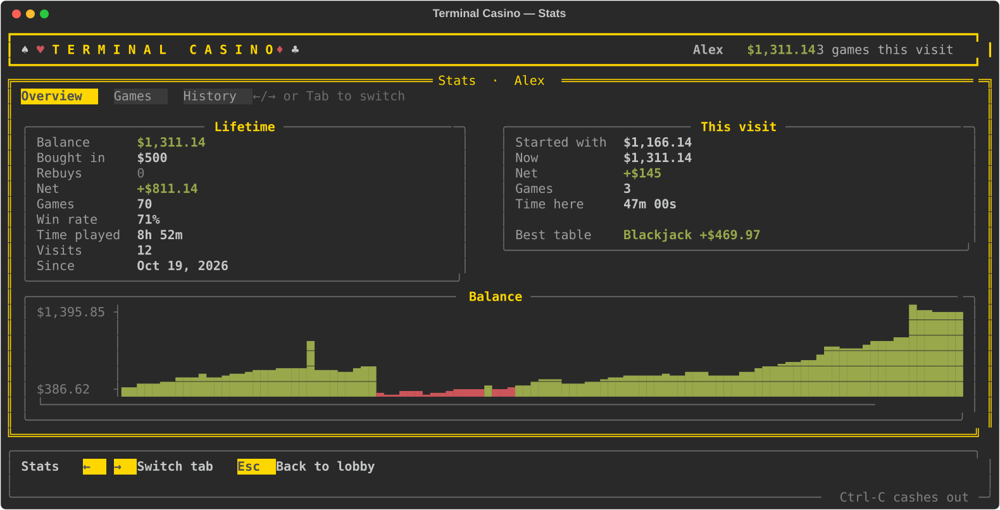
</picture>

<picture>
  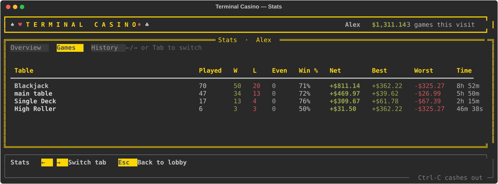
</picture>

Three tabs: **Overview** (lifetime and this visit, plus a balance chart), **Games** (per table, totalled per game), and **History** (every result, newest first).

### A bouncer for plugins

<picture>
  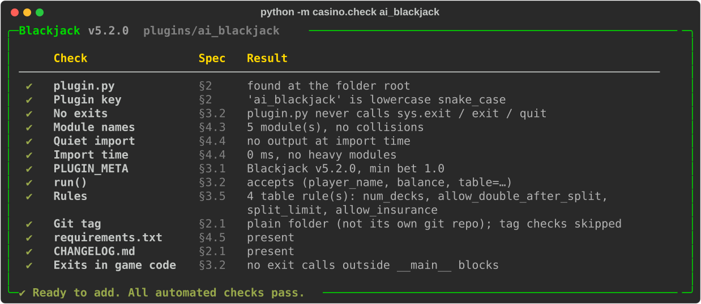
</picture>

`python -m casino.check` tests a game against the [plugin spec](docs/GAME_SPEC.md) before it goes in. The casino runs the same checks at startup and won't open a game that fails. It checks:

- the game's metadata and its `run()` signature
- that `plugin.py` imports without printing, prompting or loading heavy libraries
- that it never calls `sys.exit`
- module names that would clash with another game or the standard library
- that its version matches its git tag
- every table configured for it

## How it works

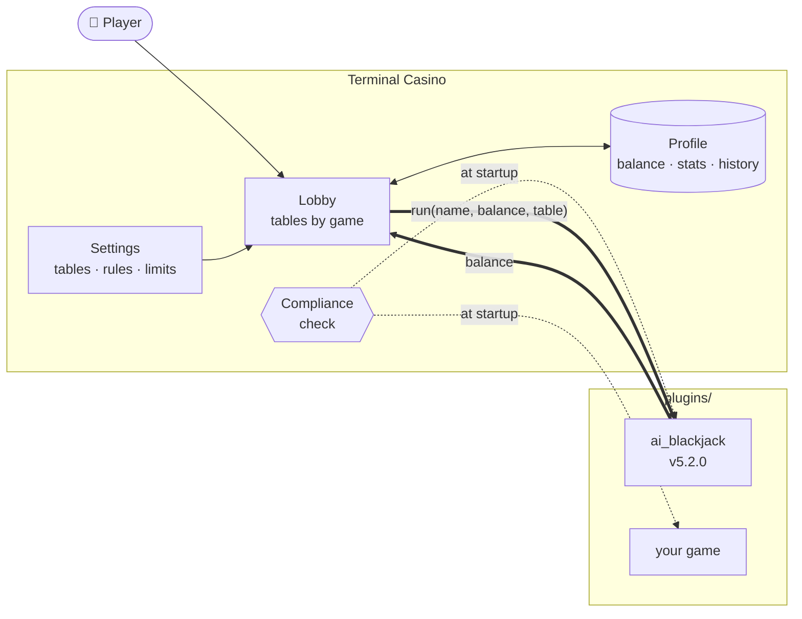

| Piece | What it does |
|---|---|
| [`main.py`](main.py) | Sign-in, lobby loop, hands the terminal to a game and takes it back |
| [`casino/tui.py`](casino/tui.py) | Full-screen Rich UI: header, felt, wallet, Casino Floor log, key-cap footer |
| [`casino/tables.py`](casino/tables.py) | Tables: build them from config, validate rules and stakes |
| [`casino/profiles.py`](casino/profiles.py) | One JSON profile per player in `profiles/`; per-table stats and history |
| [`casino/pages.py`](casino/pages.py) | The Stats and Settings pages, and the table editor |
| [`casino/compliance.py`](casino/compliance.py) | Checks a game against the spec; used at startup and by `casino.check` |
| [`casino/loader.py`](casino/loader.py) | Finds games in `plugins/` and loads the ones that pass |

**The contract** is two things in a game's `plugin.py`:

```python
PLUGIN_META = {"name": "Blackjack", "description": "Beat the dealer to 21.", "min_bet": 1.0, "version": "5.2.0",
               "rules": {"num_decks": {"type": "int", "label": "Decks", "default": 6, "min": 1, "max": 8}}}

def run(player_name: str, balance: float, table: dict | None = None) -> float:
    ...   # play until the player leaves, then return their balance
```

## Quickstart

**Download and play:** grab `terminal-casino-<version>.zip` from the [latest release](https://github.com/ianjackson8/terminal_casino/releases). It has the casino and every game in one download.

```bash
unzip terminal-casino-*.zip && cd terminal-casino-*/
python3 -m venv .venv && source .venv/bin/activate
pip install -r requirements.txt     # the casino itself only needs rich
pip install torch numpy             # for AI Blackjack
python3 main.py
```

**Or clone the repo.** The games aren't stored in git. The first time you run `python3 main.py`, the casino downloads its release's games bundle (about 0.5 MB), checks it against the checksum in `games.lock`, and unpacks it into `plugins/`. You don't need to do anything.

```bash
git clone https://github.com/ianjackson8/terminal_casino.git && cd terminal_casino
pip install -r requirements.txt && python3 main.py
```

### Controls

| Key | Lobby | Everywhere |
|---|---|---|
| `←` `→` / `h` `l` | Slide to the previous / next game | |
| `↑` `↓` / `k` `j` | Pick one of the game's tables | Move |
| `↵` or `1`–`9` | Sit down at the table | Confirm |
| `S` | Stats | |
| `G` | Settings (tables, rules, profiles) | |
| `R` | Rebuy, when you can't afford any table | |
| `Q` / `Esc` | Cash out | Back |
| `Ctrl-C` | Cash out (and autosave) | |

## Games

| Key | Game | Version | Tables | Source | Extra requirements |
|---|---|---|---|---|---|
| `ai_blackjack` | Blackjack | 5.2.0 | Standard · High Roller · Single Deck | [ai_blackjack](https://github.com/ianjackson8/ai_blackjack) | `pip install torch numpy` |
| `roulette` | Roulette | 1.2.0 | European · American · High Roller · La Partage | bundled with the release | — |
| `baccarat` | Baccarat | 1.1.0 | Main table (Punto Banco) | bundled with the release | — |
| `craps` | Craps | 1.1.0 | Standard · High Roller · 10x Odds | bundled with the release | — |
| `slots` | Slots | 1.1.1 | Main Floor · High Limit · Single Line (Diamond Sevens) · Gem Mine · Brass Bell · Night Sky | bundled with the release | — |
| `poker` | Texas Hold'em | 1.0.2 | $1/$2 No-Limit · $5/$10 Pot-Limit · Heads-Up High Roller | bundled with the release | — |

## Adding a game

1. **Build it to the [plugin spec](docs/GAME_SPEC.md).** Add a `plugin.py` with `PLUGIN_META` and `run()`. Optionally declare rules so the casino can run it at several tables.
2. **Check it** from anywhere, before it's in the casino:
   ```bash
   python3 -m casino.check ~/code/my_game
   ```
3. **Add it.** Tag a release in the game's own repo, then lock that version (the repo can be local; it doesn't need to be on GitHub):
   ```bash
   python3 scripts/games.py set my_game v1.0.0 --source ~/code/my_game
   ```
   This records the game in `games.lock` and installs it into `plugins/my_game`. To update a game later, `set` it to a new tag. For your own work in progress, put a checkout in `plugins/my_game` directly; the casino never replaces a folder it didn't install.
4. **Open tables** for it in Settings (`G`), or in `game_settings.json`:
   ```json
   {"id": "bj_high_roller", "game": "ai_blackjack", "name": "High Roller",
    "min_bet": 100, "max_bet": 5000, "rules": {"num_decks": 2, "allow_insurance": false}}
   ```

## Project layout

```
main.py                 entry point: sign-in, lobby, running tables
game_settings.json      casino settings and tables
casino/                 the casino: UI, tables, profiles, pages, loader, compliance check
games.lock              which version of each game this casino version ships with, and the bundle's checksum
plugins/<key>/          one folder per game, installed from games.lock (not stored in git)
profiles/               saved players (gitignored)
docs/GAME_SPEC.md       the plugin spec
docs/readme/            README screenshots, generated by scripts/readme_screens.py
scripts/                readme_screens.py: re-renders those screenshots from the real UI
                        game_review.py: plays a game in an emulated terminal to review it (pip install -r requirements-dev.txt)
                        games.py: lock game versions, sync plugins/, build and publish a release
```

The screenshots above are real renders of the UI, not mock-ups. Regenerate them after a UI change with `python3 scripts/readme_screens.py`.

## Roadmap

The current release is **1.0.0-beta.3**, a beta of 1.0. See the [changelog](CHANGELOG.md) for what's in it and the game versions it ships with. 1.0 is waiting on the plugin spec being frozen.

| | Milestone |
|---|---|
| ✅ | Plugin loader and full-screen lobby |
| ✅ | Profiles, saving, rebuys, stats and settings |
| ✅ | Plugin spec and compliance check, enforced at startup |
| ✅ | AI Blackjack, the first game |
| ✅ | Several tables per game, with stakes and rules set by the house |
| ✅ | Roulette: European and American wheels, la partage, a ball-and-wheel spin |
| ✅ | Baccarat: Punto Banco with Big Road and Bead Plate scoreboards |
| ✅ | Craps: the full layout with odds, place bets and props; you're the shooter |
| ✅ | Slots: four machines (Diamond Sevens, Gem Mine, Brass Bell, Night Sky), with a tested payback per table |
| ✅ | Texas Hold'em: no-limit and pot-limit against bots, side pots, rake, heads-up |
| ✅ | One house style across every game; carousel lobby |
| ✅ | Games ship with each release as one bundle; a clone installs them on first launch |
| ⏭️ | Next: freeze the plugin spec for 1.0 |
| ⬜ | More games: keno, video poker, three card poker… |
| ⬜ | Remove the legacy `plugin_overrides` setting; richer per-game results in Stats |

<p align="center">
  <sub>♠ ♥ ♦ ♣ &nbsp; Play money only. No real money is wagered, won or lost. &nbsp; ♣ ♦ ♥ ♠</sub>
</p>
